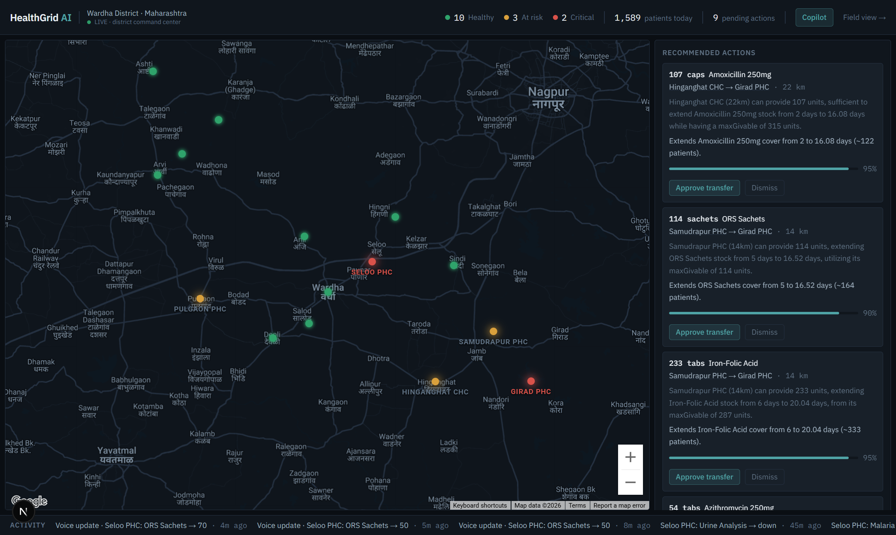
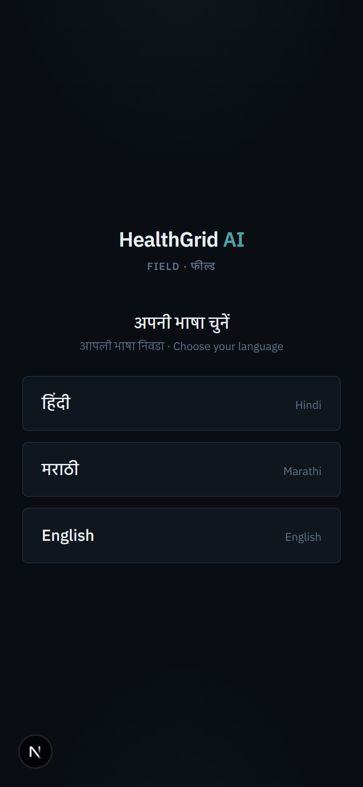
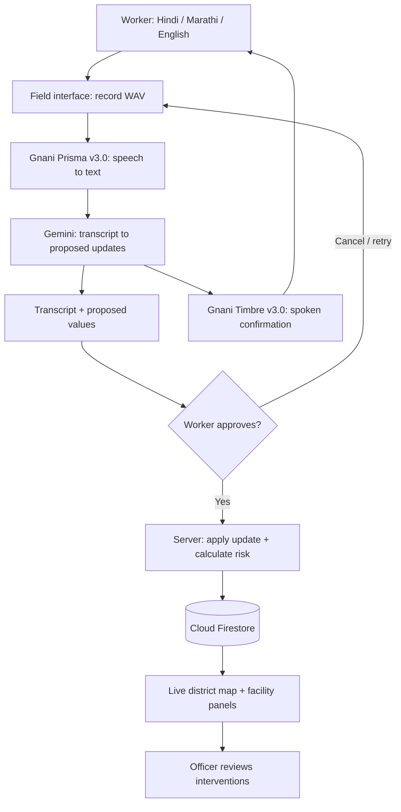
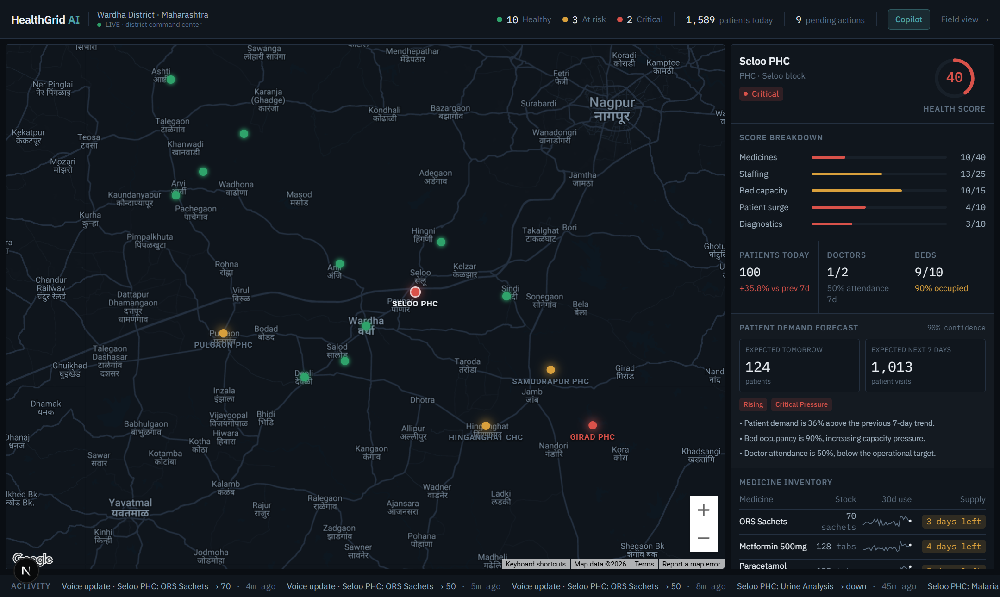

# HealthGrid AI

**Speak a facility update. Hear it back. Help the district act.**

HealthGrid AI is a voice-enabled public healthcare command center, presented for [Gnani AI's Great Indian AI Internship Challenge](https://www.gnani.ai/internship). It connects a frontline health worker's spoken report to a live district view of medicine stock, available doctors, occupied beds, and diagnostic readiness.

**Gnani is the core of HealthGrid's voice workflow:** Prisma turns a worker's speech into text, and Timbre reads the proposed update back before the worker approves it. That exchange makes the operational dashboard usable from the field, where typing a detailed report can interrupt patient-facing work.

[Explore the speech integration](lib/gnani.ts) · [Field interface](components/field/VoiceUpdate.tsx) · [Gnani developer docs](https://docs.gnani.ai) · [API console](https://app.gnani.ai/voice)



## The problem: decisions need information from the field

A district can only respond to a medicine shortage or a staffing gap when someone reports it. A worker may know that only 50 ORS packets remain, that two doctors are present, or that the diagnostic machine has stopped working, while the district still sees yesterday's information.

HealthGrid gives that worker a short, spoken reporting workflow and gives the district a shared view of what changed. The intended users are:

- **Frontline workers at PHCs and CHCs:** report facility conditions in the language they use at work.
- **District health officers:** see changing risk, inspect shortages, and review possible interventions.
- **Facility teams:** receive operational notifications and acknowledge follow-up actions.

The application focuses on facility operations: inventory, staffing, beds, and diagnostics.

## Why Gnani is central

The voice interaction is the bridge between the person at the facility and the district's decision tools. Both sides of that interaction use Gnani.

| Gnani component | Role in HealthGrid | Why it matters |
| --- | --- | --- |
| **Prisma speech-to-text** | Transcribes the worker's recording before structured extraction begins. | Spoken updates become information the application can process, without requiring the worker to fill out each field manually. |
| **Timbre text-to-speech** | Speaks the proposed confirmation in the selected interface language. | The worker can listen to the interpretation, review the quantities, and decide whether to save it. |
| **Gnani Speech APIs** | Run behind HealthGrid's server routes using a server-side API key. | The browser can offer recording and playback without exposing the speech API credential. |

Prisma supplies the transcript used by the rest of the voice pipeline. If transcription fails, the application asks the worker to retry; it does not silently send the audio to another speech provider. Timbre supplies audible feedback, with the written confirmation still available if playback fails. Manual entry remains available.

**Gnani powers listening and speaking.** Gemini supports text interpretation and district explanations; deterministic application logic calculates risk and forecasts; Firestore distributes confirmed changes. These components give the spoken report somewhere useful to go.

## Challenge models and the implementation in this repository

HealthGrid uses Gnani's flagship speech-model families **Prisma v2.5** and **Timbre v2.5**, with the following versions in the current code:

| Speech capability | Model highlighted by the challenge | Current HealthGrid default |
| --- | --- | --- |
| Speech-to-text | **Prisma v2.5** | **Prisma v3.0** — `prisma-v3.0` |
| Text-to-speech | **Timbre v2.5** | **Timbre v3.0** — `timbre-v3.0`, voice `Shivani` |

The current implementation is documented in [`lib/gnani.ts`](lib/gnani.ts) and [`.env.example`](.env.example). **This checkout uses v3.0 defaults; it is not a verified v2.5 deployment.**

Prisma v2.5 is relevant to the same field-reporting task: it accepts a chosen language and supports transcription with number formatting. Timbre v2.5 provides speech generation with voices suited to particular languages. See the official [Prisma v2.5 reference](https://docs.gnani.ai/api/STT/models/prisma-v2-5), [Timbre API reference](https://docs.gnani.ai/api/TTS/tts-inference), and [voice catalog](https://docs.gnani.ai/api/TTS/available-voices).

For anyone adapting this checkout to v2.5: the `/stt/v3` URL is an API version, not a model version. Prisma v2.5 needs an explicit language for REST requests, while HealthGrid currently sends `indic-auto`. Timbre v2.5 also needs a voice from its own catalog; `Shivani` belongs to v3.0. Changing only the two model environment variables is therefore insufficient. The current v3.0 integration is retained here.

## From a spoken update to a district action

For example, a worker can report:

> “आज ओआरएस का स्टॉक 50 बचा है और दो डॉक्टर आए हैं।”

The intended meaning is: **50 ORS packets remain, and two doctors are present.**

1. **Speak.** On `/field`, the worker selects a facility and interface language, then holds the microphone button. The browser captures mono, 16 kHz WAV audio and stops recording before 30 seconds.
2. **Transcribe with Prisma.** `POST /api/ai/voice` sends the recording to Gnani. The current Prisma v3.0 configuration uses automatic language detection.
3. **Interpret the transcript.** Gemini receives the text and the selected facility's current state. It proposes structured updates and a confirmation in the worker's interface language. “50 remaining” and “50 used” are treated as different instructions.
4. **Listen with Timbre.** For a proposal that passes the interface's confidence threshold, `POST /api/ai/speak` generates the spoken confirmation. The transcript and proposed values are also shown on screen, and the confirmation can be replayed.
5. **Approve.** The worker confirms or cancels. Recording and transcription alone do not save an update.
6. **Update the district.** Confirmation sends the proposed values to the facility update route. A Firestore transaction applies the change and recalculates facility risk; realtime listeners update the district view.

The field interface offers **Hindi, Marathi, and English**. Examples for demonstrating the workflow include:

| Interface language | Example report | Intended update |
| --- | --- | --- |
| Hindi | “आज ओआरएस का स्टॉक 50 बचा है।” | Set ORS stock to 50. |
| Marathi | “आज दोन डॉक्टर आले आहेत.” | Set doctors present to two. |
| English | “Only 50 ORS packets are left and two doctors are present.” | Update stock and doctor attendance together. |
| Hindi with English terms | “ORS stock 50 बचा है।” | Test a familiar mixed-language reporting pattern. |

These are suggested demo inputs, not a published speech-accuracy benchmark. Review the actual transcript and proposed values before confirming.

<p align="center">
  
</p>

## Architecture



The recording is processed as a short REST request after capture. HealthGrid does not currently implement continuous speech streaming or a telephone calling interface.

### Code to inspect

| File | Responsibility |
| --- | --- |
| [`lib/gnani.ts`](lib/gnani.ts) | Gnani authentication, model defaults, STT requests, and TTS synthesis. |
| [`lib/wav-recorder.ts`](lib/wav-recorder.ts) | Browser microphone capture and WAV encoding. |
| [`app/api/ai/voice/route.ts`](app/api/ai/voice/route.ts) | Prisma transcription followed by structured interpretation of the transcript. |
| [`app/api/ai/speak/route.ts`](app/api/ai/speak/route.ts) | Timbre confirmation audio returned as WAV. |
| [`components/field/VoiceUpdate.tsx`](components/field/VoiceUpdate.tsx) | Record, review, listen, retry, cancel, and confirm interactions. |
| [`app/api/actions/update-facility/route.ts`](app/api/actions/update-facility/route.ts) | Apply confirmed updates in a Firestore transaction. |
| [`lib/engine/`](lib/engine/) | Risk scoring, stock-out forecasting, and transfer guardrails. |

## What the district can do with the update

| Capability | Operational purpose |
| --- | --- |
| **Live facility map** | Show changing facility conditions and risk scores as confirmed reports arrive. |
| **Stock-out forecasts** | Estimate days of supply from stock, consumption, and patient trends. |
| **Facility explanations** | Use Gemini to explain risks using the available facility data. |
| **Guarded transfer proposals** | Suggest redistribution from surplus facilities, with server-side quantity limits and officer approval. |
| **Health Copilot** | Answer questions through tools that read district and facility data. |
| **Operational notifications** | Send facility reports in-app, optionally through WhatsApp, and track read and acknowledgement state. |
| **District PDF report** | Export a situation report using the same risk and forecast engines as the dashboard. |



The value of the voice workflow is the connection: a worker's Gnani-powered report supplies fresh information for these decisions.

## Run locally

Use Node.js 20 or later, a Gnani API key, a Gemini API key, a Firebase project with Firestore access, and a Google Maps browser key.

```bash
git clone https://github.com/Noida-Boys/Healthgrid-AI-Submission.git
cd Healthgrid-AI-Submission
npm ci
```

Copy [`.env.example`](.env.example) to `.env.local` (`Copy-Item .env.example .env.local` in PowerShell, or `cp .env.example .env.local` in Bash).

### Configure Gnani first

Create a key in the [Gnani API console](https://app.gnani.ai/voice). The current application defaults are:

```dotenv
GNANI_API_KEY=your_gnani_api_key
GNANI_STT_MODEL=prisma-v3.0
GNANI_TTS_MODEL=timbre-v3.0
GNANI_TTS_VOICE=Shivani
```

Keep `GNANI_API_KEY` server-side. For deployment, provide it through the runtime secret manager; [`apphosting.yaml`](apphosting.yaml) already references a secret with that name.

Fill in the remaining values in `.env.local`:

```dotenv
GEMINI_API_KEY=your_gemini_api_key
NEXT_PUBLIC_FIREBASE_API_KEY=your_firebase_web_key
NEXT_PUBLIC_FIREBASE_PROJECT_ID=your_project_id
NEXT_PUBLIC_FIREBASE_APP_ID=your_firebase_app_id
NEXT_PUBLIC_MAPS_API_KEY=your_maps_browser_key
```

Firebase Admin can use Application Default Credentials:

```bash
gcloud auth application-default login
gcloud config set project YOUR_PROJECT_ID
```

Alternatively, set the optional `FIREBASE_SERVICE_ACCOUNT_B64` value described in `.env.example`. Keep local environment files and service-account credentials out of Git.

```bash
npm run check-keys
npm run seed
npm run dev
```

`check-keys` checks the existing Gemini, Firestore, and Maps configuration; it does **not** validate Gnani credentials. Verify Gnani by completing the voice walkthrough below. Seeding writes generated demo data to the configured Firestore project; use a dedicated demo project.

Open `http://localhost:3000` for the district dashboard and `http://localhost:3000/field` for the worker interface. Microphone access requires localhost or HTTPS and browser permission.

## A demo that shows Gnani working

1. Open the district dashboard and the field interface side by side, selecting the same facility.
2. Choose Hindi, Marathi, or English in the field interface.
3. Record a short synthetic facility report, such as the ORS example above.
4. Show Prisma's transcript alongside the proposed stock or staffing values.
5. Play Timbre's spoken confirmation; replay it with the confirmation control if the browser blocks automatic playback.
6. Confirm the update, then show the changed facility state and recalculated risk in the district view.
7. Inspect the resulting forecast or intervention options to show why the report matters.

For troubleshooting, inspect `/api/ai/voice` and `/api/ai/speak` in the browser's Network panel. A successful transcription response includes the transcript and STT metadata; the speech route returns WAV audio. Missing credentials or upstream speech failures should be fixed before recording the submission demo.

## Evaluation and demo data

The demo uses a generated district based on Wardha geography and facility types, with synthetic inventory, staffing, patient activity, and historical records. It is a demonstration dataset, not a live health-system deployment.

```bash
npm test
npm run lint
npx tsx scripts/impact-sim.ts
```

The tests cover application behavior, including deterministic engines and server workflows. The impact script simulates transfer decisions over generated data; its output is a scenario result, not measured clinical impact. Neither replaces testing the speech APIs with real recordings made for the demo.

The application does not publish measured word-error rate, speech latency, or noisy-audio accuracy. Gnani's platform benchmarks should not be read as HealthGrid measurements. Test the displayed languages, medicine names, quantities, and readback on the device used for the demonstration.

The repository currently has demo-oriented access controls. Authentication and facility-level authorization remain necessary before using it with real operational data. See [deployment notes](docs/DEPLOY.md) for the existing hosting setup.

## Challenge alignment and team

HealthGrid addresses the challenge's practical-use focus through rural health reporting, with a visible role for both Gnani speech APIs. Its strongest demonstration is the full path from a worker's voice to a confirmed operational update.

The [challenge instructions](https://www.gnani.ai/internship) ask entrants to identify their models, explain each member's contribution, and nominate a public working-demo post. Use the actual deployed model versions when submitting. Demo posts should include **#GnaniAI** and **#GreatIndianAIInternshipChallenge**; prepare the individual contribution details alongside the submission.

**Team Noida Boys:** Nishant Rajpathak and Saatvik Das.

This submission builds on the [earlier HealthGrid project](https://github.com/Noida-Boys/Healthgrid-AI), with Gnani-powered field reporting and spoken confirmation as the focus of this challenge presentation.
